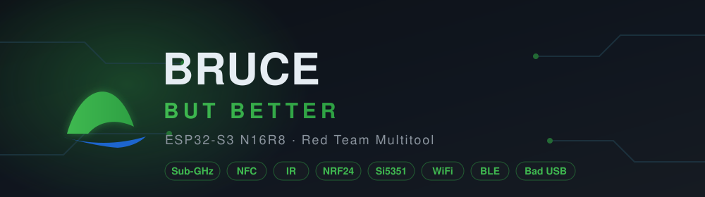
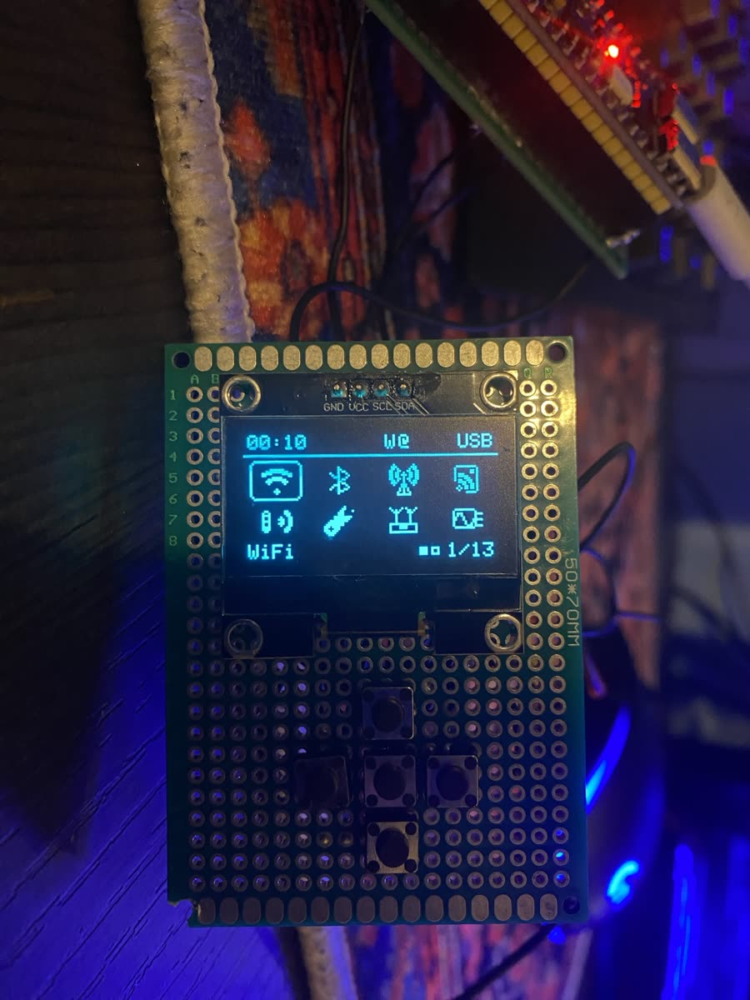
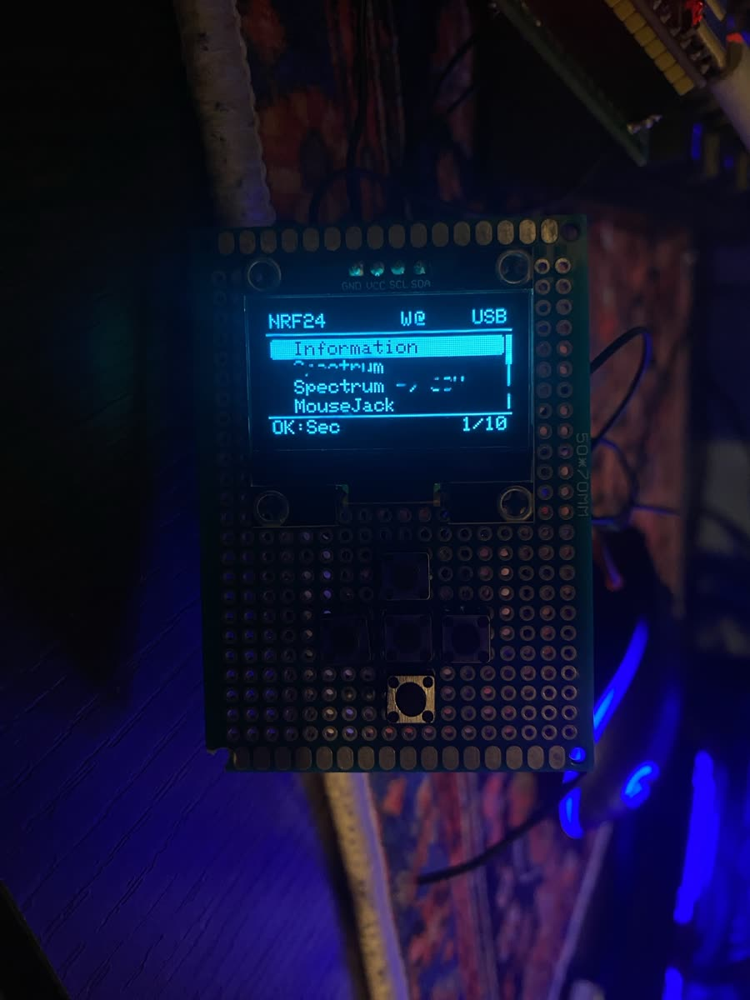
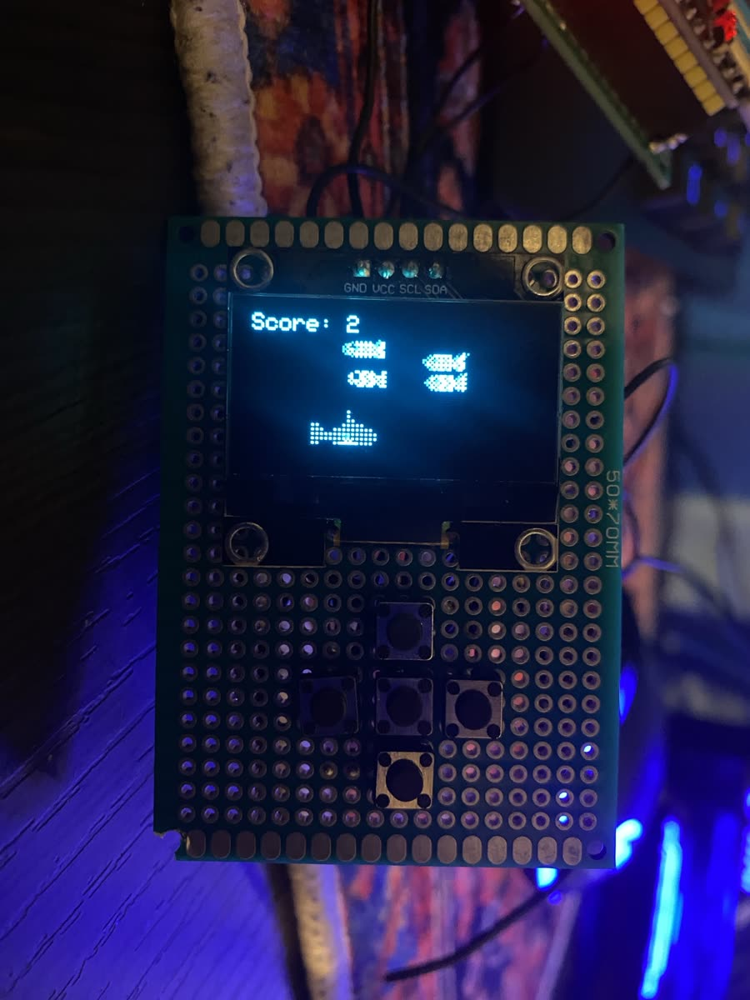
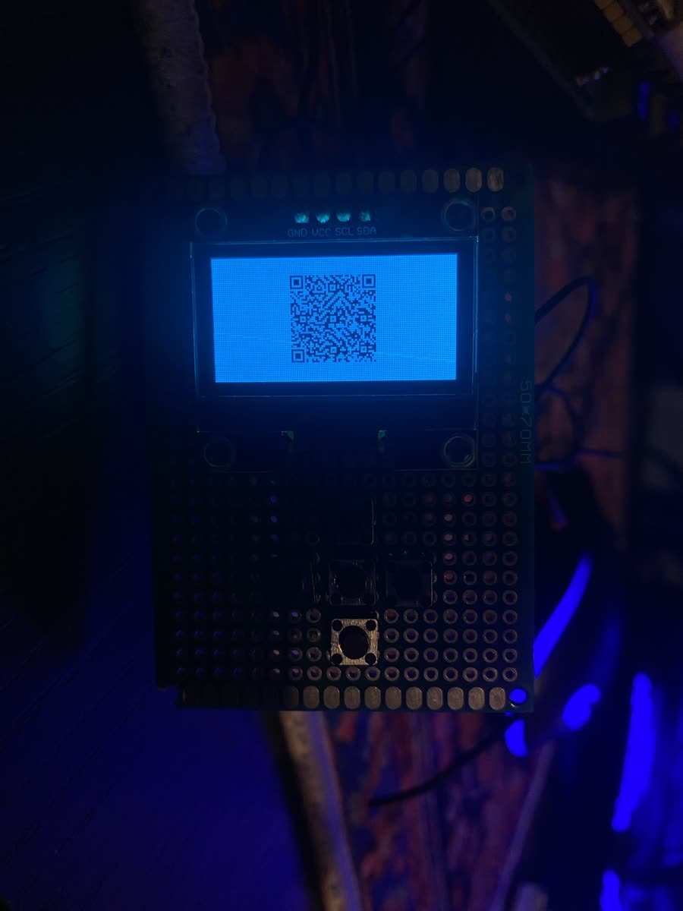

<div align="center">



# BRUCE BUT BETTER — ESP32-S3 N16R8

**A hand-built Flipper Zero-style multitool on the ESP32-S3.**
Downstream fork of the [Bruce](https://github.com/pr3y/Bruce) firmware.

Sub-GHz · NFC/RFID · IR · WiFi/BLE · NRF24 · Si5351 — one device, one binary.

[](https://github.com/pr3y/Bruce)
[](https://www.espressif.com/en/products/socs/esp32-s3)
[](./LICENSE)

</div>

---

> ## ⚠️ VERY EARLY BETA
> This project is in **very early beta**. Expect bugs, breaking changes, and half-finished
> features. Nothing here is stable yet — flash it, build it, and use it **at your own risk**.

> **Legal** — For **authorized** security testing and education only. Unauthorized or malicious
> use is prohibited. You assume all responsibility. Distributed under AGPL.

---

## What is it?

A DIY handheld built on the **ESP32-S3 N16R8** running a custom fork of Bruce. One firmware
binary drives every chip; modules are detected at runtime, so a missing part just shows a
"not found" message instead of crashing.

**What's different from upstream Bruce:** a purpose-built DIY board (`ESP-General`), a UI tuned
for the 1.3" 128×64 mono OLED, and a few extra modules — most notably an **Si5351 signal
generator** (8 kHz–160 MHz), an NRF24 sniffer, and a hardware self-test that probes the I²C/SPI
buses and reports every module that answers. Everything else tracks upstream.

<p align="center">
  
  
  
  
</p>
<p align="center"><sub>Screen + button board on a 50×70 mm protoboard: icon grid main menu, a submenu list, a game and a QR code.</sub></p>

## Build one (~$40)

Full parts list, wiring, and assembly: **[DIY build guide →](./docs/BUILD.md)**

| Tier | Parts | Cost |
|---|---|---|
| Minimum | ESP32-S3 + OLED + buttons | ~$13 |
| Recommended | + CC1101 + PN532 + IR + microSD | ~$25 |
| Full | + 2× NRF24 + Si5351 + battery | ~$40 |

## Flash it

**Easiest — [browser flasher](https://Yoursel71.github.io/BruceButBetter/):** open in desktop
Chrome/Edge, pick your board, connect the **left USB-C** (UART), click Flash. No toolchain.

**Manual** (grab a `.bin` from [Releases](https://github.com/Yoursel71/BruceButBetter/releases)):

```sh
esptool.py --chip esp32s3 --port COMx write_flash 0x0 Bruce-esp32-s3-N16R8.bin
```

> Linux/Mac: use `/dev/ttyACM0` instead of `COMx`.

## Build from source

Needs [PlatformIO](https://platformio.org/).

```sh
pio run -e esp32-s3-devkitc-1-psram            # build (default: SH1106, 6 buttons)
pio run -e esp32-s3-devkitc-1-psram -t upload  # build + flash
pio run -e esp32-s3-devkitc-1-psram-ssd1306    # build for an SSD1306/SSD1315 OLED
```

The `ESP-General` board drives a 128x64 I2C OLED over the same wiring regardless of panel; pick the
environment that matches the module and buttons you actually fitted:

| environment | flash | panel | buttons |
|---|---|---|---|
| `esp32-s3-devkitc-1` | 8 MB | SH1106 / SSD1106G | 6 |
| `esp32-s3-devkitc-1-psram` | 16 MB | SH1106 / SSD1106G | 6 — **default** |
| `esp32-s3-devkitc-1-psram-ssd1306` | 16 MB | SSD1306 / SSD1315 | 6 |
| `esp32-s3-devkitc-1-psram-ssd1306-4btn` | 16 MB | SSD1306 / SSD1315 | 4 |

The full board wires six buttons (UP/DOWN/LEFT/RIGHT/OK/BACK on GPIO 15/16/38/39/40/41). The
`-4btn` variant is for builds that only wire UP/DOWN/OK/BACK: it drops LEFT/RIGHT and walks the
keyboard/menu grid plus the RF-frequency and Karma-channel controls with UP/DOWN instead
(`-DNO_LR_BUTTONS=1`, which you can add to any other environment too). SH1106 panels need a 132x64
GRAM with a 2 px column offset; SSD1306/SSD1315 use 128x64 with no offset — the wrong one leaves the
screen dark. See [`boards/ESP-General/ESP-General.ini`](./boards/ESP-General/ESP-General.ini) and
[`boards/ESP-General/pins_arduino.h`](./boards/ESP-General/pins_arduino.h) for the full pin map.

Output lands in `.pio/build/esp32-s3-devkitc-1-psram/firmware.bin`. The full upstream board
matrix (M5Stack, CYD, Lilygo, Marauder …) is ported in too — build any with `pio run -e <env>`.
See [`boards/`](./boards) for the list and [`docs/BUILD.md`](./docs/BUILD.md) for hardware details.

## What it does

| Domain | Highlights |
|---|---|
| **WiFi** | AP/scan, beacon spam, deauth, evil portal, sniffer (wardriving needs GPS, which the ESP-General build does not include) |
| **BLE** | Scan, Bad BLE (Ducky), pairing spam |
| **Sub-GHz (CC1101)** | Scan/copy, replay, spectrum, jammer |
| **NFC/RFID (PN532)** | Read/clone/write, NDEF, emulation |
| **IR** | TV-B-Gone, receive, custom codes |
| **NRF24** | Mousejack, 2.4G spectrum, jammer |
| **Si5351** | Signal gen 8 kHz–160 MHz, sweep, AM band |
| **Bad USB** | Ducky scripts over native USB |
| **Extras** | JS interpreter, WebUI, file manager, QR, iButton |

> **Warning** — jammers and deauth are illegal to operate against equipment you don't own in most
> places. Use only on your own hardware, or where you hold written authorization.

## Contributing

**Vote on what comes next:** [feature poll](https://github.com/Yoursel71/BruceButBetter/discussions/12). Ideas go in
[Discussions → Ideas](https://github.com/Yoursel71/BruceButBetter/discussions/categories/ideas).

**Want to help?** Pull requests are welcome, small ones too. Good places to start:
[good first issue](https://github.com/Yoursel71/BruceButBetter/issues?q=is%3Aissue+is%3Aopen+label%3A%22good+first+issue%22) and
[help wanted](https://github.com/Yoursel71/BruceButBetter/issues?q=is%3Aissue+is%3Aopen+label%3A%22help+wanted%22). Comment on the issue
first so two people don't work on the same thing. Read [CONTRIBUTING.md](./CONTRIBUTING.md) and
confirm it compiles with `pio run -e esp32-s3-devkitc-1-psram` before opening a PR.

**Built one?** Post a photo in [Show and tell](https://github.com/Yoursel71/BruceButBetter/discussions/categories/show-and-tell).

## Credits

Downstream fork of [**Bruce**](https://github.com/pr3y/Bruce). All upstream credit to
[@pr3y](https://github.com/pr3y), [@bmorcelli](https://github.com/bmorcelli), and the Bruce
contributors. Improvements here are meant to flow back upstream.

- Upstream: https://github.com/pr3y/Bruce · Wiki: https://wiki.bruce.computer

## License

AGPL — see [LICENSE](./LICENSE).
</content>
</invoke>
