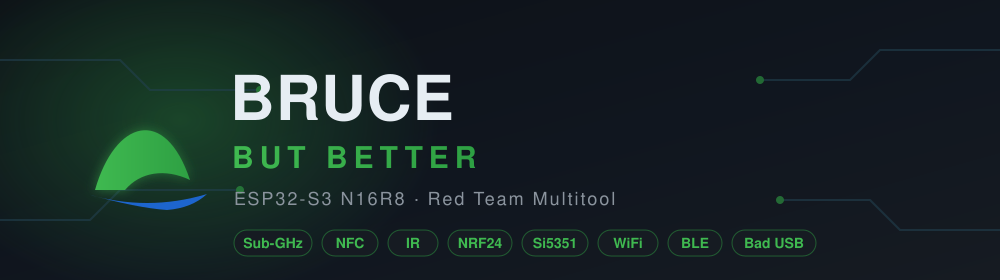
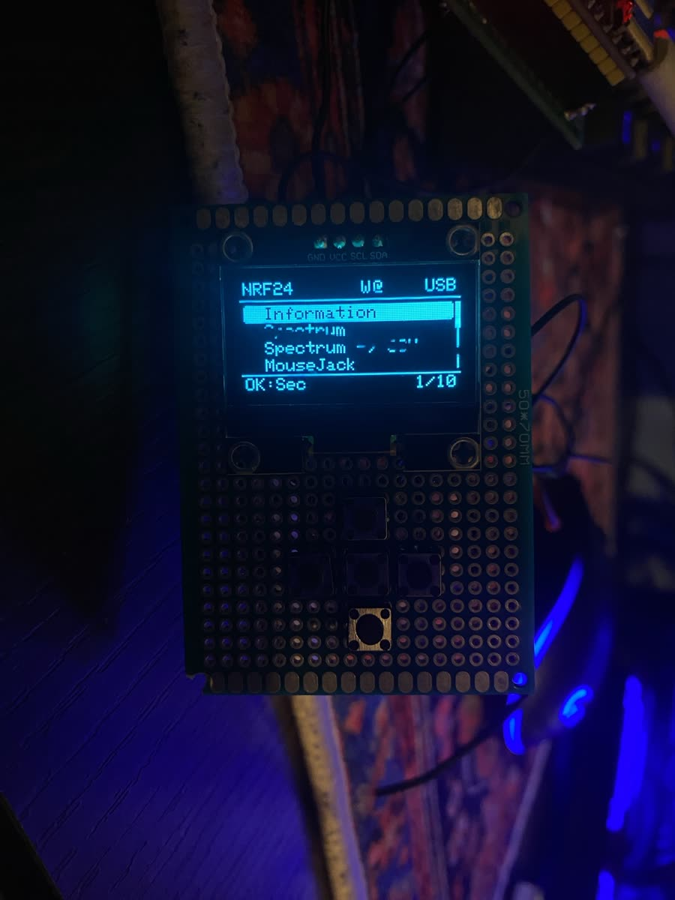
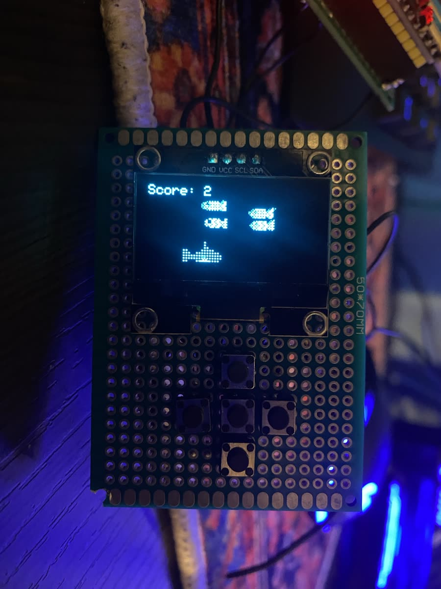
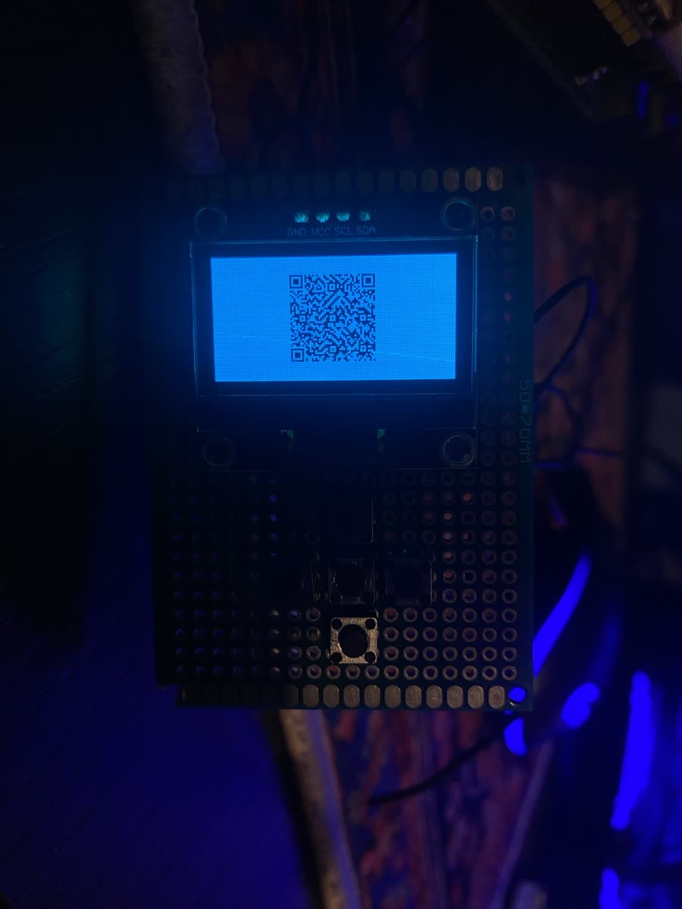

<div align="center">



# BRUCE BUT BETTER — ESP32-S3 N16R8

**A hand-built Flipper Zero-style multitool on the ESP32-S3.**
Downstream fork of the [Bruce](https://github.com/pr3y/Bruce) firmware.

Sub-GHz · NFC/RFID · IR · WiFi/BLE · NRF24 · Si5351 — one device, one binary.

[](https://github.com/pr3y/Bruce)
[](https://www.espressif.com/en/products/socs/esp32-s3)
[](./LICENSE)

</div>

---

> ## ⚠️ VERY EARLY BETA
> This project is in **very early beta**. Expect bugs, breaking changes, and half-finished
> features. Nothing here is stable yet — flash it, build it, and use it **at your own risk**.

> **Legal** — For **authorized** security testing and education only. Unauthorized or malicious
> use is prohibited. You assume all responsibility. Distributed under AGPL.

---

## What is it?

A DIY handheld built on the **ESP32-S3 N16R8** running a custom fork of Bruce. One firmware
binary drives every chip; modules are detected at runtime, so a missing part just shows a
"not found" message instead of crashing.

**What's different from upstream Bruce:** a purpose-built DIY board (`ESP-General`), a UI tuned
for the 1.3" 128×64 mono OLED, and a few extra modules — most notably an **Si5351 signal
generator** (8 kHz–160 MHz), an NRF24 sniffer, and a hardware self-test that probes the I²C/SPI
buses and reports every module that answers. Everything else tracks upstream.

<p align="center">
  
  
  
  
</p>
<p align="center"><sub>Screen + button board on a 50×70 mm protoboard: icon grid main menu, a submenu list, a game and a QR code.</sub></p>

## Build one (~$40)

Full parts list, wiring, and assembly: **[DIY build guide →](./docs/BUILD.md)**

| Tier | Parts | Cost |
|---|---|---|
| Minimum | ESP32-S3 + OLED + buttons | ~$13 |
| Recommended | + CC1101 + PN532 + IR + microSD | ~$25 |
| Full | + 2× NRF24 + Si5351 + battery | ~$40 |

## Flash it

**Easiest — [browser flasher](https://Yoursel71.github.io/BruceButBetter/):** open in desktop
Chrome/Edge, pick your board, connect the **left USB-C** (UART), click Flash. No toolchain.

**Manual** (grab a `.bin` from [Releases](https://github.com/Yoursel71/BruceButBetter/releases)):

```sh
esptool.py --chip esp32s3 --port COMx write_flash 0x0 Bruce-esp32-s3-N16R8.bin
```

> Linux/Mac: use `/dev/ttyACM0` instead of `COMx`.

## Build from source

Needs [PlatformIO](https://platformio.org/).

```sh
pio run -e esp32-s3-devkitc-1-psram            # build
pio run -e esp32-s3-devkitc-1-psram -t upload  # build + flash
```

Output lands in `.pio/build/esp32-s3-devkitc-1-psram/firmware.bin`. The full upstream board
matrix (M5Stack, CYD, Lilygo, Marauder …) is ported in too — build any with `pio run -e <env>`.
See [`boards/`](./boards) for the list and [`docs/BUILD.md`](./docs/BUILD.md) for hardware details.

## What it does

| Domain | Highlights |
|---|---|
| **WiFi** | AP/scan, beacon spam, deauth, evil portal, sniffer (wardriving needs GPS, which the ESP-General build does not include) |
| **BLE** | Scan, Bad BLE (Ducky), pairing spam |
| **Sub-GHz (CC1101)** | Scan/copy, replay, spectrum, jammer |
| **NFC/RFID (PN532)** | Read/clone/write, NDEF, emulation |
| **IR** | TV-B-Gone, receive, custom codes |
| **NRF24** | Mousejack, 2.4G spectrum, jammer |
| **Si5351** | Signal gen 8 kHz–160 MHz, sweep, AM band |
| **Bad USB** | Ducky scripts over native USB |
| **Extras** | JS interpreter, WebUI, file manager, QR, iButton |

> **Warning** — jammers and deauth are illegal to operate against equipment you don't own in most
> places. Use only on your own hardware, or where you hold written authorization.

## Contributing

Bug fixes, modules, board ports, and docs are all welcome — see
[CONTRIBUTING.md](./CONTRIBUTING.md). Confirm it compiles with
`pio run -e esp32-s3-devkitc-1-psram` before opening a PR.

## Credits

Downstream fork of [**Bruce**](https://github.com/pr3y/Bruce). All upstream credit to
[@pr3y](https://github.com/pr3y), [@bmorcelli](https://github.com/bmorcelli), and the Bruce
contributors. Improvements here are meant to flow back upstream.

- Upstream: https://github.com/pr3y/Bruce · Wiki: https://wiki.bruce.computer

## License

AGPL — see [LICENSE](./LICENSE).
</content>
</invoke>
